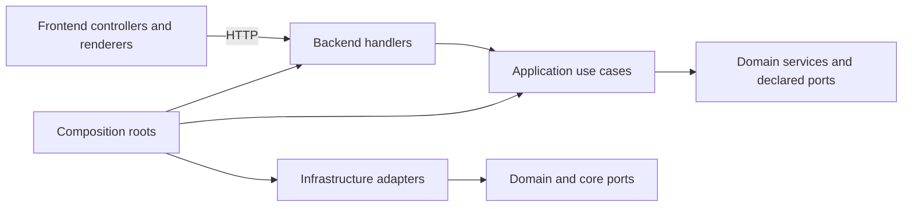

# Application architecture

MathPDF has two independently built applications. The frontend owns pages, styles, browser state, PDF.js, KaTeX and print presentation. The backend owns identity, authorization, durable content, generation, accounting and report collection. They communicate through HTTP; neither application reads the other's source tree or filesystem at runtime.

## Ownership

| Location | Responsibility |
| --- | --- |
| `front/app/features/` | Account, library, workspace, annotations, study, generation and administration controllers |
| `front/app/core/` | Browser storage, cancellable JSON requests, bounded diagnostics and navigation guards |
| `front/app/rendering/` | Shared math projection, source glyph rendering, PDF viewer and print document |
| `front/scripts/` | Asset build, development gateway and frontend checks |
| `front/tests/` | Isolated browser scenarios and readable HTML/JavaScript harnesses |
| `back/app/identity/` | Accounts, one-use OAuth flows, sessions and role policies |
| `back/app/documents/`, `annotations/` | Owner-scoped document metadata, deletion rules and vector annotation contracts |
| `back/app/study/`, `generation/` | Compatible content contracts, persistence, provider-neutral output expansion and generation lifecycle |
| `back/app/library/`, `reviews/` | Organization, archive placement and separate learning progress |
| `back/app/usage/`, `reports/`, `administration/` | Daily admission, durable observations, reports and administrative read projections |
| `back/app/formula_extraction/` | Offline formula contracts, stored presentation trees and explicit variants |
| `back/app/application/use_cases/` | One cross-domain operation per file |
| `back/app/core/` | Technical ports, errors, serialization, journals and correlated JSON logging |
| `back/app/infrastructure/` | SQL engines/schema/migrations, object storage, OAuth/AI SDKs, PDF processing and HTTP delivery |
| `back/app/bootstrap/` | Explicit construction, route assembly and lifespans |
| `back/tests/` | Domain, repository, API and compatibility checks |
| `tests/integration/` | Cross-application HTTP acceptance checks |
| `contracts/` | Historical route/fixture/prompt baseline and source ownership inventory |
| `infrastructure/` | Container orchestration, optional logging pipeline and architecture tooling |

`contracts/source-ownership.json` maps the former flat package to its current owners. Historical fixture files in `tests/fixtures/` remain canonical; the backend carries identical copies so its tests can run independently.

## Dependency direction

Models and policies do not import handlers, composition roots or infrastructure SDKs. SQL repositories implement persistence contracts and own atomic writes. Application use cases coordinate multiple domains. Handlers decode HTTP input, call an explicitly supplied operation and encode its result. Infrastructure is assembled only in composition roots. The immutable `Services` composition record contains declared collaborators; it does not implement business operations or dynamically acquire services.

Backend startup initializes tables and indexes in a fixed infrastructure sequence. PostgreSQL processes take a session advisory lock around this sequence so app, admin and reports can start concurrently without racing their `CREATE TABLE` statements. Normal writes retain their separate transaction lock.

Public browser component interfaces are explicit factory return objects backed by classes with private state. Existing `MathPDF`, `MathPDFSession` and `FormulaLab` browser facades remain where classic scripts require them. Page controllers assemble features; generation polling, annotation history, review rounds, layout, storage and request parsing have their own collaborators.

## Transaction and lifecycle invariants

| Operation | Boundary preserved |
| --- | --- |
| Save annotation copy | One copy per original; expected revision checked under the write lock; binary cleanup follows committed metadata |
| Delete document | Primary-source sets and annotation copies cascade; context-only references detach; report-pinned source revisions remain available |
| Save study set | Canonical payload remains opaque JSON text; ownership and source authorization precede the write |
| Review answer | Round ownership and answer idempotency checked in one transaction; progress is separate from study content |
| Reserve generation | Daily allowance and concurrent reservations checked atomically before provider dispatch |
| Observe provider usage | Immutable effective tariff, exact decimal costs and original completion time survive durable replay |
| Collect report | Five-minute lease; conditional completion/retry prevents a stale collector from overwriting a newer lease |

| Generation state | Lifecycle |
| --- | --- |
| Admitted | The shared lock is acquired before scheduling a background job |
| Running | One provider HTTP request; request/job context is bound for the task |
| Cancelled before start | Cancellation explicitly releases admission even if the coroutine never entered |
| Failed or timed out | The complete operation ends; quota failures retain their dedicated response and do not become automatic bug reports |
| Completed | The exact requested set is returned; no partial result or extra model repair round is introduced |
| Finished | Context is reset, lock released and bounded finished-job retention applied |

## HTTP and assets

The public gateway serves `/`, `/workspace`, `/admin` and stable `/static/` URLs. API/auth requests route privately to app, admin or reports. The backend authorizes protected HTML through `/internal/access`; this endpoint and the frontend asset port are private. Authentication cookies, same-origin checks, account headers, error statuses and request references retain their existing contracts.

The frontend publishes a version 1 asset manifest on its private port. Backend PDF export fetches the print template and shared renderer through this HTTP contract, verifies content digests and blocks external browser requests. It never imports or mounts frontend source. Build identifiers and no-store HTML prevent mixed cached pages; persisted draft/cache keys retain their previous names.

## Compatibility

This refactor changes ownership and dependency structure, not persisted formats. An absent study-set version still means version 1. Existing formulas, variants, references, user text, annotation revisions, folders, archive state, role grants, usage observations and review fingerprints remain readable. Missing optional fields retain compatible defaults. Prompt text and hashes are unchanged. PostgreSQL payload columns remain text; library projection parses JSON in Python, including historical values PostgreSQL JSONB cannot represent.

Data directories, SQL migration identifiers, cookie names, source digests and object keys retain their previous values. An unsupported unowned legacy database is rejected without deleting its tables. A breaking format change still requires the owner's explicit approval.

## Function and boundary checks

Every first-party Python/JavaScript function, constructor and callback must be at most 50 physical lines after formatting. This includes tests, scripts and executable browser harnesses. Vendor libraries, generated distributions and generated graph output are excluded. The architecture inventory reports location/name/span and checks source isolation, route coverage and historical digests. Tests exercise behavior separately; a static inventory is not evidence that a runtime scenario passed.
